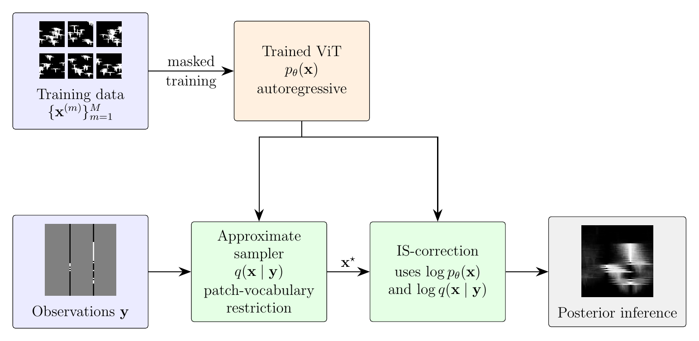

# Vision Transformer for Binary Spatial Fields: Learned Probabilities and Posterior Inference



Code for the manuscript "Vision Transformer for Binary Spatial Fields: Learned Probabilities and Posterior Inference" (Brinchmann, Ovanger, Eidsvik, Hauge, Skauvold), prepared for submission to Computers & Geosciences.

## Abstract

We present Vision Transformers (ViTs) for conditional sampling of binary random fields. Unlike new generative AI models like diffusion models or variational approaches, ViTs provide two advantages for data conditioning. First, their autoregressive tokenization yields explicit patch-level probabilities, allowing direct computation of the approximate log-probability mass function (PMF). Second, masked-token training enables conditioning on arbitrary observation geometries without retraining or architectural changes. Using the trained ViT as a prior model, we derive an importance-sampling correction for a patch-vocabulary-restricted approximate posterior sampler.
Validated against two Markov random field benchmark models with exact known prior and posterior solutions, the ViT prior shows near-linear agreement between its log-PMF and the true log-PMF ($R^2 > 0.997$), with a mild 5 to 6 percent compression of the scale.
Applied to process-based fluvial geology realizations, where no closed-form PMF exists, the ViT reproduces the main structure of the realizations, with realistic clustering structures and conditional coverage. For a single deep well, the importance-sampling posterior mean reduces the mean squared error against an exact-match reference by a factor of about six relative to the unconditional mean. At the same time, the fixed vocabulary cap prevents enforcing well observations at higher resolution.

## Overview

This repository contains the code for using a ViT as a prior for binary spatial fields, and for posterior inference with the ViT prior combined with importance sampling. Two Markov random field (MRF) models with exact priors and posteriors are used to validate the method (Sections 2 and 3 of the paper). The method is then applied to fluvial 64x64 realizations from the GEOPARD program (Section 4).

Naming: Model A in the code is Model I in the paper, and Model D in the code is Model II. Models B and C, Gaussian-noise and summed (well-sum) observations, and random-pixel observation layouts come from the thesis the work builds on (Brinchmann, 2026). They are included as extensions and are not used in the paper (see "Thesis extensions and extra scripts").

## Repository layout

| Folder | Contents |
|---|---|
| `common/` | Shared modules: the ViT (`ViT_rectangle.py` for the MRF models, `ViT_rowonly.py` for the fluvial model), sampling and training code, exact MRF samplers and marginals, and the attention scripts (`attention_maps.py`, `plot_attention.py`) |
| `paper/` | Models A and D: data generation, training, evaluation, exact posteriors, importance-sampling runs, plotting. Also holds the thesis extensions for these models |
| `geopard/` | Fluvial (GEOPARD) scripts: downsizing, training, unconditional generation, well experiment, plotting, vocabulary statistics |
| `extra_thesis_models/` | Models B and C from the thesis. Not used in the paper and not guaranteed to run end to end |
| `minimal_example/` | Small end-to-end test for model A that runs on CPU |
| `data/` | Datasets, including the 64x64 fluvial images `fluvial_binary_64x64.h5` |
| `outputs-model-A/`, `outputs-model-B/`, `outputs-model-C/`, `outputs-model-D/` | Trained checkpoints for the four MRF models (A and D are used in the paper) |
| `checkpoints_fluvial_64_rowonly_bigger/` | Trained checkpoint of the final fluvial model |
| `docs/` | Images used in this README |

## Installation

```
git clone https://github.com/brinchtor/vit-field-prior
cd vit-field-prior
pip install -e .
```

`pip install -e .` installs the dependencies with minimum versions and makes the modules in `common/` importable from every script. `requirements.txt` pins the exact package versions used for the experiments on the cluster (PyTorch 2.5.1, which needs Python 3.12 or older; the pinned install was tested with Python 3.11). The minimal example has also been run with Python 3.14.2 and PyTorch 2.15 (CPU).

Run all scripts from the repository root, for example `python paper/train_MRF_model_A.py`. Scripts read and write relative paths such as `data/` and `outputs-model-A/`, which are the folders in the repository root.

## Quick start: minimal example

```
python minimal_example/run_all.py
```

This runs five small steps for model A on a 12x24 grid with tiny sizes: generate a dataset, train a small ViT, compare ViT and exact log-likelihoods, compute exact marginals, and run importance-sampling posterior inference with a small number of samples. It takes about 5 minutes on a CPU. All outputs go to `minimal_example/out/`. The results illustrate the pipeline and are not comparable to the paper results.

## Reproducing the paper results

The full runs need a GPU and long run times: about 4 hours per MRF training run (one A100), and 40-50 hours for the GEOPARD training run. The trained checkpoints and the fluvial dataset used for the paper are included in the repository, so sampling runs and figures can be regenerated without retraining: `outputs-model-A/` and `outputs-model-D/` (models A and D), `checkpoints_fluvial_64_rowonly_bigger/` (final fluvial model), `data/fluvial_binary_64x64.h5` (64x64 fluvial images), and `outputs-model-B/` and `outputs-model-C/` (thesis models, not used in the paper). The MRF training and observation data are generated by the scripts below. Sampling runs and figures are regenerated by running the scripts in the listed order; intermediate outputs are not included.

### MRF benchmarks (Sections 2 and 3)

Scripts are in `paper/`; replace `A` with `D` for the other model. The paper uses exact pixel observations along two wells.

1. Training data: `generate_samples_MRF.py` (A), `generate_samples_MRF_2nd_iniso.py` (D).
2. Training: `train_MRF_model_A.py`, `train_MRF_model_D.py`.
3. Unconditional samples: notebooks `Test1000Model-model-A.ipynb`, `Test1000Model-model-D.ipynb`.
4. Log-likelihood evaluation: `eval_logliks.py` (A), `eval_logliks_D.py` (D).
5. Well observations: `generate_mrf_datasets_{A,D}.py`.
6. Exact posterior: `generate_mrf_conds_{A,D}_wells.py`, `eval_exact_{A,D}.py`.
7. IS-ViT posterior: `conditional_model_{A,D}_wells.py`.
8. Attention maps (Fig. 2): `common/attention_maps.py` computes the attention data and `common/plot_attention.py` plots it.

### Fluvial application (Section 4)

Scripts are in `geopard/`. The model uses the row-embedding ViT (`common/ViT_rowonly.py`, `ViT_sampling_rowonly.py`, `training_rowonly.py`).

1. Downsizing to 64x64: `downsize_fluvial.py`.
2. Training: `train_fluvial_64_rowonly_bigger.py` (checkpoints in `checkpoints_fluvial_64_rowonly_bigger/`).
3. Unconditional samples: `generate_all_checkpoints_rowonly_bigger.py` (raster order), `generate_rowonly_bigger_random.py` (random order), `generate_rowonly_bigger_revraster.py` (reverse raster order).
4. Conditional example and well benchmark (Section 4.2): `well_experiment.py`, with the figures made by `well_plots.py`.
5. Vocabulary coverage (Table 5): `patch_count_fluvial_64.py`, `patch_count_fluvial_128.py`, `columns_missing.py`, `compute-table-stats.py`. Occurrence counts are computed from the training data, so the table does not depend on which training run is used (the vocabularies of the earlier and final runs are identical).

`GEOPARD_fluvial.ipynb` builds additional figures from precomputed sample files (`conditional_samples_fluvial_64_10k.npz`, `unconditional_samples_fluvial_64.npz`). These are not included; the notebook is not needed for the paper figures.

### Figures

| Paper element | Script |
|---|---|
| Fig. 2 (attention maps) | `common/attention_maps.py`, `common/plot_attention.py` |
| Figs 3-4, Tables 2-3 (unconditional MRF results) | `paper/plot_chapter4_new.py` |
| Figs 6-7 (exact-observation experiment) | `paper/plot_cond_exp.py` |
| Figs 8, 10 (fluvial samples, cluster counts) | `geopard/plot_fluvial.py` |
| Fig. 9 (ViT mean minus test mean, by generation order) | `geopard/plot_diff_by_order.py` |
| Figs 11-13 (conditional example and well benchmark) | `geopard/well_plots.py` |
| Table 5 (vocabulary coverage) | `geopard/patch_count_fluvial_*.py`, `columns_missing.py`, `compute-table-stats.py` |

## Thesis extensions and extra scripts

These scripts are not used in the paper: the `*_gauss_*` (Gaussian-noise observations), `*_summed_*` (well-sum observations), `conditional_model_long_*` and `*_random.py` (random-pixel layouts) scripts, `plot_gauss_exp.py`, `plot_summed.py`, `plot_long.py`, `ess_plot.py`, `ess_plot_summed.py`, `plot_frontpage.py`, and everything in `extra_thesis_models/`. In `geopard/`, `plot_diff_by_epoch.py` and `plot_diff_by_epoch_new.py` plot how the unconditional samples change over training epochs, using the checkpoint samples from `generate_all_checkpoints_rowonly_bigger.py`. Other scripts in `geopard/` that are not listed in the pipeline above are earlier experiments and diagnostics.

## Inputs, outputs and options

Each script documents its inputs and outputs in the docstring at the top, and its main parameters (grid size, number of samples, observation settings, paths) are set in variables at the top of the file. Typical file flow: `data/*.npz` (datasets and observations) -> `outputs-*/` and `checkpoints_*/` (checkpoints) -> `data/cond_exp/*.npz` (posterior results) -> figures.

## GEOPARD data

The fluvial realizations come from the GEOPARD program (Aarnes et al., 2026), a simulated dataset. The downsized 64x64 images (`fluvial_binary_64x64.h5`) are included in `data/`. `geopard/downsize_fluvial.py` produces them from the raw file `02_fluvial_binary_images.h5`, which is not included. The scripts expect the HDF5 file under `data/` unless stated in the script.

## Known issues

This is research code, written for a thesis and adapted for this release.

- Scripts assume they are run from the repository root, and many use hardcoded relative paths.
- Some stages expect files that earlier stages write under a different name or folder: `conditional_model_*` read `data/obs_*.npz` while the generators write `data/cond_exp/obs_*.npz`, and the MRF training scripts write `checkpoints_MRF_model_X/` while evaluation scripts and notebooks read `outputs-model-X/`. Move or rename by hand.
- Model C has no training script. `extra_thesis_models/` is included for completeness only.
- During release preparation only the minimal example was executed. The other scripts were checked statically (they compile and all imports resolve).

## Citation

The manuscript is under preparation for submission. If you use this code before publication, please cite it as:

Brinchmann, T. F., Ovanger, O., Eidsvik, J., Hauge, R., and Skauvold, J. Vision Transformer for Binary Spatial Fields: Learned Probabilities and Posterior Inference. Manuscript submitted to Computers & Geosciences.

Journal reference and DOI will be added after publication.

## License

MIT. See `LICENSE`.